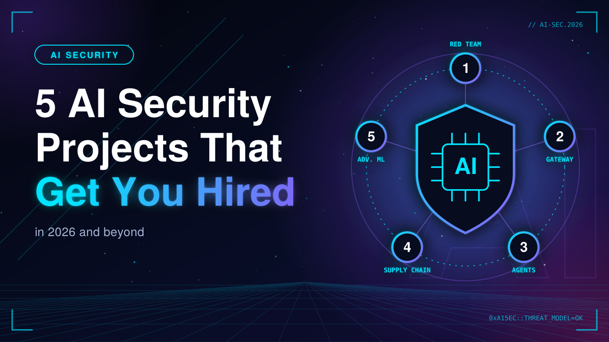

# AI Security Projects

Hands-on projects that attack, defend and measure real AI systems: LLMs, agents, the model supply chain and classic ML.

📝 Read the full article on Medium: [5 AI Security Projects That Will Get You Hired in 2026 (and Beyond)](https://medium.com/@georgebotrs37/5-ai-security-projects-that-will-get-you-hired-in-2026-and-beyond-d953450812f5)

## Projects

| # | Project | What it shows | Status |
|---|---|---|---|
| 01 | [LLM Red Teaming Lab](./llm-red-teaming-lab) | Build a deliberately vulnerable LLM app (RAG chatbot + tools + a system prompt with secrets), attack it systematically, and write a real pentest-style report. | 🚧 |
| 02 | [Prompt Injection Defense Gateway](./prompt-injection-gateway) | A proxy layer between users and an LLM that filters input and output, isolates untrusted context, and logs everything, with an evaluation harness that measures it honestly. | 🚧 |
| 03 | [Secure an Agentic AI System](./agentic-ai-security) | Attack and then harden an agent that has tools (files, web, database). | 🚧 |
| 04 | [AI Supply Chain Security Scanner](./ai-supply-chain-scanner) | Treat models as untrusted software artifacts: scan for unsafe serialization, generate an AI Bill of Materials, verify integrity and gate model use in CI. | 🚧 |
| 05 | [Adversarial ML: Attack, Defend, Measure](./adversarial-ml) | Attack classical ML models (not just LLMs): evasion, poisoning and privacy attacks, then defend and measure the accuracy vs robustness trade-off. | ✅ |

## Frameworks used

[OWASP Top 10 for LLM Applications](https://genai.owasp.org/) · [MITRE ATLAS](https://atlas.mitre.org/) · [NIST AI RMF](https://www.nist.gov/itl/ai-risk-management-framework)

## Responsible use

This repository is for education and defensive research. Test only systems you own or are explicitly authorized to test. Never publish working malware.

## License

MIT

## Author

**George Botrs Azer**
Junior SOC Analyst | SIEM, Log Analysis, Threat Detection
