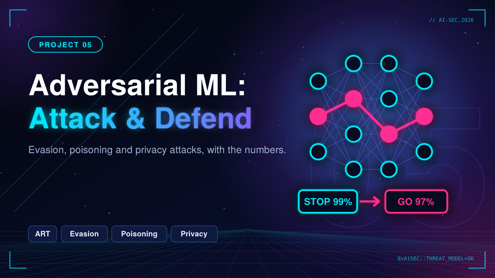
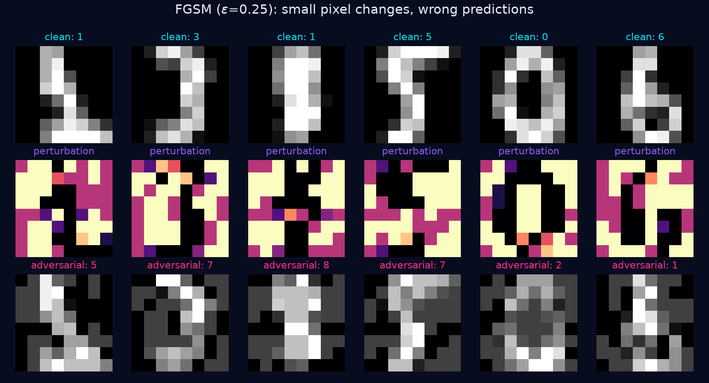
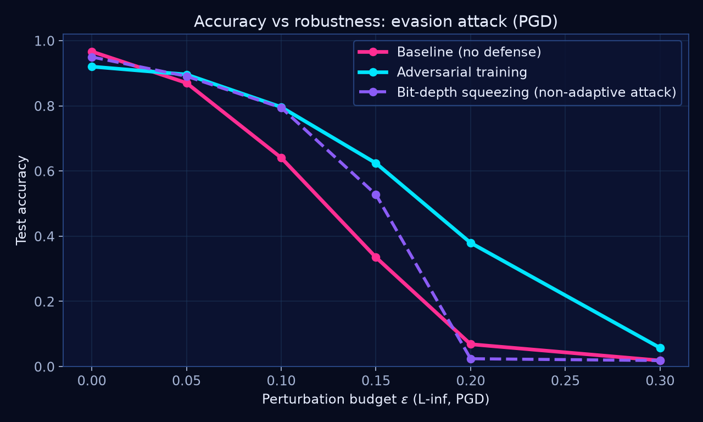
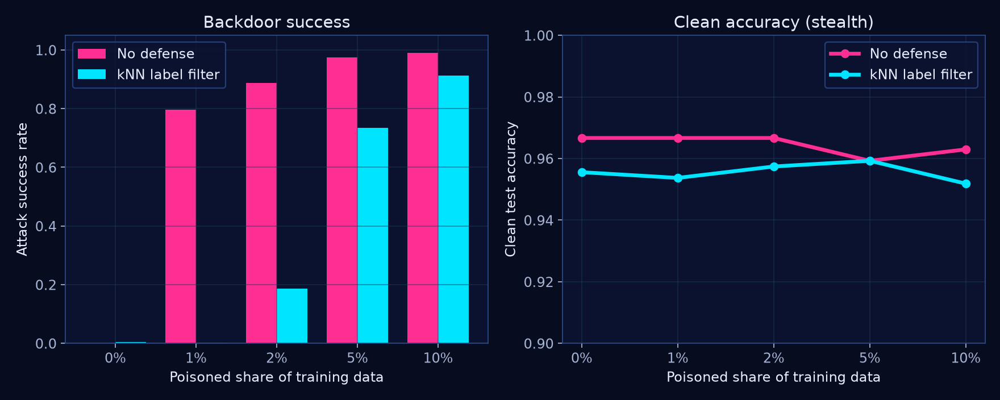
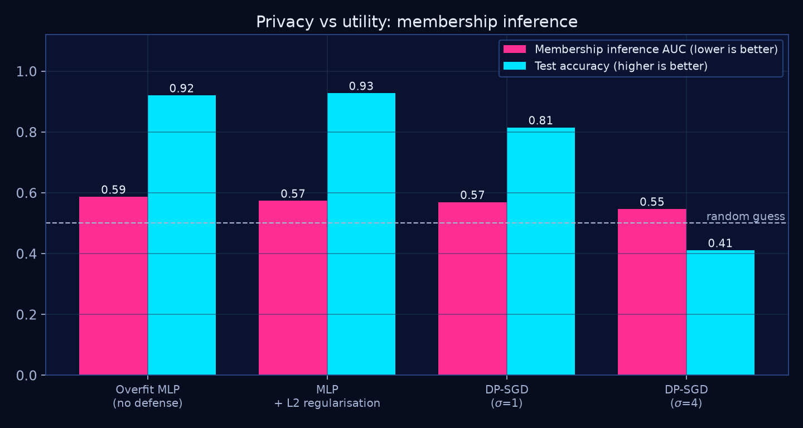

# 05. Adversarial ML: Attack, Defend, Measure



Not every AI system is an LLM. This project attacks classic ML models three ways (evasion, data poisoning, privacy), applies a defense to each, and **measures** what the defense actually buys and what it costs.

> Status: ✅ v1 complete. Everything below is reproduced by one command: `python run_all.py`

## TL;DR (real numbers from this repo)

| Attack | Undefended | With defense | Cost of the defense |
|---|---|---|---|
| **Evasion** (PGD, eps=0.15) | 33.5% accuracy | **62.4%** with adversarial training | -4.7 pts clean accuracy (96.7% to 92.0%) |
| **Backdoor** (1% poisoned data) | **79.6%** attack success, clean accuracy unchanged | 0.2% with kNN label filter | ~1 pt clean accuracy |
| **Backdoor** (10% poisoned data) | 99.0% attack success | **91.4%**: the filter breaks down | - |
| **Membership inference** | AUC 0.587 (advantage 0.275) | AUC 0.569 with DP-SGD (sigma=1) | -10.5 pts accuracy (92.0% to 81.5%) |

Security is a trade-off, and the charts show it.

## Threat model

| | Evasion | Poisoning | Privacy |
|---|---|---|---|
| **Attacker goal** | Make the model misclassify a specific input | Plant a backdoor trigger | Learn whether a record was in the training set |
| **Capability** | White-box gradient access, L-inf budget eps | Can tamper with a small fraction of training data | Black-box access to output probabilities |
| **When** | Inference time | Training time | Inference time |
| **Framework** | MITRE ATLAS: Evade ML Model | MITRE ATLAS: Poison Training Data | MITRE ATLAS: Infer Training Data Membership |

Dataset: scikit-learn `digits` (8x8 images, scaled to [0,1]). Small on purpose: every experiment runs in about a minute on a laptop with no GPU and no downloads.

## 1. Evasion: adversarial examples

FGSM and PGD from the [Adversarial Robustness Toolbox (ART)](https://github.com/Trusted-AI/adversarial-robustness-toolbox) against a logistic-regression classifier.



**Defenses**
- **Adversarial training** (`defenses/adversarial_training.py`): PGD runs *inside* the training loop on every minibatch (min-max training). My first attempt, which augmented the dataset once with pre-computed adversarial examples, barely helped, so the attack must be in the loop.
- **Bit-depth squeezing** (`defenses/input_preprocessing.py`): evaluated only against a *non-adaptive* attacker.



| eps | Baseline | Adversarial training | Squeezing (non-adaptive) |
|---|---|---|---|
| 0 | 96.7% | 92.0% | 95.0% |
| 0.05 | 87.0% | 89.6% | 89.1% |
| 0.1 | 64.1% | 79.6% | 79.4% |
| 0.15 | 33.5% | 62.4% | 52.8% |
| 0.2 | 6.9% | 38.0% | 2.4% |
| 0.3 | 1.9% | 5.7% | 1.9% |

## 2. Poisoning: backdoor

A 2x2 white patch in the corner plus a flipped label (to class 7) on a small share of the training set. The model keeps its normal accuracy, so nothing looks wrong, but any input with the patch is classified as 7.

**Defense:** kNN label-consistency filter (`defenses/poisoning_filter.py`). A poisoned sample looks like one digit but carries another digit's label, so its nearest neighbours disagree with its label. Flag those and drop them before training.



| Poisoned | Clean acc | Attack success | Attack success (filtered) | Filter precision | Filter recall |
|---|---|---|---|---|---|
| 0% | 96.7% | 0.0% | 0.4% | - | - |
| 1% | 96.7% | 79.6% | 0.2% | 30.2% | 100.0% |
| 2% | 96.7% | 88.7% | 18.7% | 39.6% | 84.0% |
| 5% | 95.9% | 97.5% | 73.5% | 51.7% | 47.6% |
| 10% | 96.3% | 99.0% | 91.4% | 41.1% | 18.3% |

**Finding:** the filter is excellent at low poisoning rates and fails at high ones, because once many poisoned samples exist their neighbours are poisoned too. Clean accuracy never reveals the backdoor, which is why you need data-level defenses and not just accuracy monitoring.

## 3. Privacy: membership inference

Loss-threshold attack (`attacks/privacy.py`): training members tend to have lower loss than unseen records. AUC 0.5 means no leakage.

**Defenses:** L2 regularisation, and DP-SGD (`defenses/privacy_defenses.py`: per-sample gradient clipping plus Gaussian noise, implemented in numpy).



| Model | Test acc | MIA AUC | MIA advantage |
|---|---|---|---|
| Overfit MLP (no defense) | 92.0% | 0.587 | 0.275 |
| MLP + L2 regularisation | 92.8% | 0.574 | 0.210 |
| DP-SGD (sigma=1) | 81.5% | 0.569 | 0.135 |
| DP-SGD (sigma=4) | 41.1% | 0.547 | 0.120 |

**Finding:** privacy is not free. Noise that pushes leakage close to random destroys utility. L2 regularisation is the cheapest first step.

## Limitations (read this before quoting the numbers)

- **Toy scale.** 8x8 digits and linear/small models. The *shape* of the trade-offs transfers; the exact numbers do not. Next step: CIFAR-10 with a CNN.
- **Squeezing is not a real defense.** It was tested only against a non-adaptive attacker and collapses at eps=0.2. An adaptive attacker who knows about it can bypass it.
- **Adversarial training is only as strong as the attack used.** Robustness was measured with 20-step PGD; stronger attacks (AutoAttack) would lower the numbers.
- **The kNN filter breaks at high poison rates** (see table) and needs clean-ish neighbours.
- **DP-SGD here reports the noise multiplier sigma, not a formal (epsilon, delta).** A privacy accountant is needed for a formal guarantee.
- Single random seed. Confidence intervals over multiple seeds are a TODO.

## Run it

```bash
cd adversarial-ml
pip install -r requirements.txt
python run_all.py        # writes charts + results.json + RESULTS.md to results/
```

## Layout

```
adversarial-ml/
├── common.py                    data, seeds, plot style
├── run_all.py                   runs every experiment, writes results/
├── attacks/
│   ├── evasion.py               FGSM, PGD via ART
│   ├── poisoning.py             backdoor trigger + attack success rate
│   └── privacy.py               loss-threshold membership inference
├── defenses/
│   ├── adversarial_training.py  in-loop PGD min-max training
│   ├── input_preprocessing.py   bit-depth squeezing
│   ├── poisoning_filter.py      kNN label-consistency filter
│   └── privacy_defenses.py      DP-SGD softmax regression
├── notebooks/
└── results/                     charts, results.json, RESULTS.md
```

## References

- Goodfellow et al., *Explaining and Harnessing Adversarial Examples* (FGSM)
- Madry et al., *Towards Deep Learning Models Resistant to Adversarial Attacks* (PGD, adversarial training)
- Gu et al., *BadNets* (backdoors)
- Yeom et al., *Privacy Risk in Machine Learning* (membership inference)
- Abadi et al., *Deep Learning with Differential Privacy* (DP-SGD)
- [MITRE ATLAS](https://atlas.mitre.org/) · [OWASP ML Security Top 10](https://owasp.org/www-project-machine-learning-security-top-10/)

## Responsible use

Runs on a public toy dataset in a local environment. Do not use these techniques against systems you do not own or are not authorized to test.
