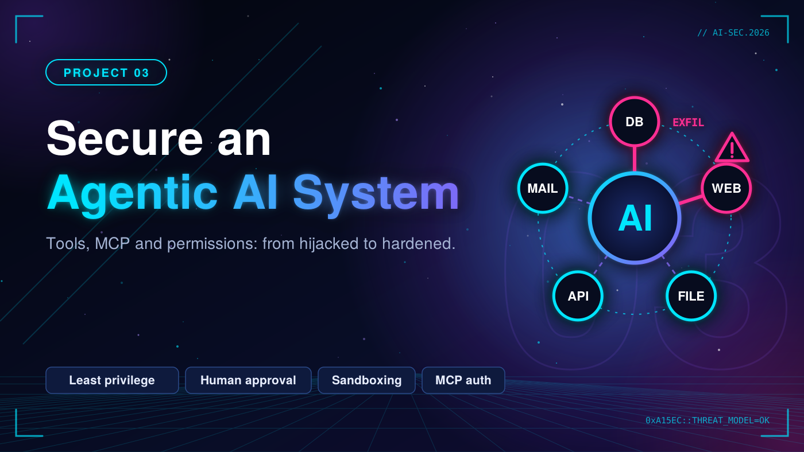

# 03. Secure an Agentic AI System



Attack and then harden an agent that has tools (files, web, database). Shows how indirect prompt injection becomes a real incident, and how least privilege and approvals stop it.

> Status: 🚧 In progress

## Goal and threat model

_Describe the system, trust boundaries, assets, attacker capabilities and attack paths. Add a diagram (STRIDE / MITRE ATLAS)._

## Tools

- MCP
- STRIDE / MITRE ATLAS (threat model)
- Sandboxing (containers)

## Roadmap

- [ ] Weak agent: over-broad permissions, no confirmations, unauthenticated tool server
- [ ] Demonstrated attack: malicious page or document hijacks the agent to exfiltrate data
- [ ] Hardened agent: least-privilege scoped credentials per tool
- [ ] Human-in-the-loop approval for sensitive actions
- [ ] Sandboxed code execution
- [ ] Allowlists for domains and tool arguments
- [ ] Authentication and validation on MCP servers
- [ ] One-page threat model in `threat-model/`

## Repository layout

```
agentic-ai-security/
├── agent-vulnerable/
├── agent-hardened/
├── attacks/
└── threat-model/
```

## Results

| Scenario | Vulnerable agent | Hardened agent |
|---|---|---|
| _Indirect injection via web page_ | _Data exfiltrated_ | _Blocked_ |

## Limitations

_Be honest about what this does not cover or cannot stop._

## References

- OWASP Top 10 for LLM Applications
- MITRE ATLAS
- NIST AI RMF

## Responsible use

Everything here targets my own lab environment or open-source/authorized targets only.
