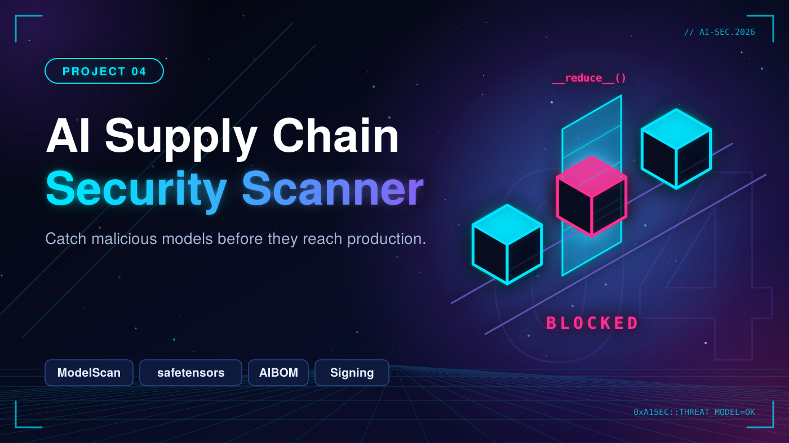

# 04. AI Supply Chain Security Scanner



Treat models as untrusted software artifacts: scan for unsafe serialization, generate an AI Bill of Materials, verify integrity and gate model use in CI.

> Status: 🚧 In progress

## Goal and threat model

_Describe the system, trust boundaries, assets, attacker capabilities and attack paths. Add a diagram (STRIDE / MITRE ATLAS)._

## Tools

- ModelScan
- picklescan
- safetensors
- CycloneDX (AIBOM)
- GitHub Actions
- Sigstore / signing

## Roadmap

- [ ] Scan model files for unsafe serialization and suspicious payloads
- [ ] Flag risky formats and prefer safetensors
- [ ] AIBOM generator: model, source, datasets, dependencies (CycloneDX)
- [ ] Integrity checks and signing of approved models
- [ ] CI: GitHub Action that blocks a PR pulling an unvetted model
- [ ] Safe PoC: a harmless pickle that is caught by the scanner (isolated environment, never real malware)

## Repository layout

```
ai-supply-chain-scanner/
├── scanner/
├── aibom/
├── ci/
└── samples/
```

## Results

| Artifact | Format | Verdict | Reason |
|---|---|---|---|
| _model.pkl_ | pickle | _Blocked_ | _Unsafe deserialization_ |

## Limitations

_Be honest about what this does not cover or cannot stop._

## References

- OWASP Top 10 for LLM Applications
- MITRE ATLAS
- NIST AI RMF

## Responsible use

Everything here targets my own lab environment or open-source/authorized targets only.
