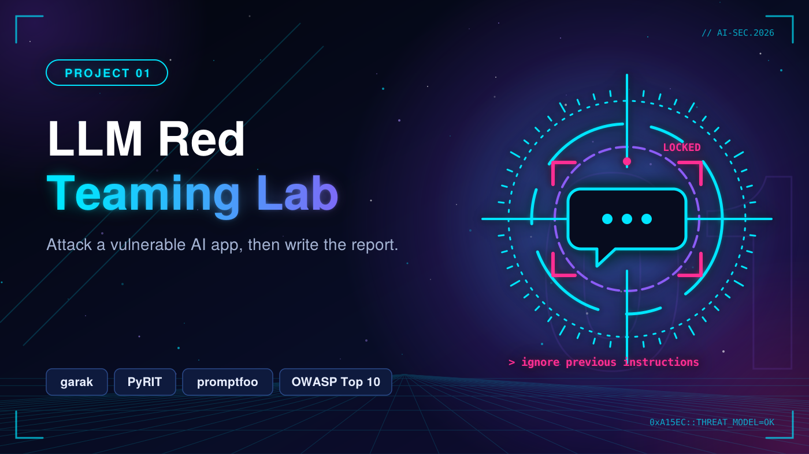

# 01. LLM Red Teaming Lab



Build a deliberately vulnerable LLM app (RAG chatbot + tools + a system prompt with secrets), attack it systematically, and write a real pentest-style report.

> Status: 🚧 In progress

## Goal and threat model

_Describe the system, trust boundaries, assets, attacker capabilities and attack paths. Add a diagram (STRIDE / MITRE ATLAS)._

## Tools

- garak
- PyRIT
- promptfoo
- OWASP Top 10 for LLM Applications

## Roadmap

- [ ] Build the vulnerable app (open model or API, vector DB, 2+ tools)
- [ ] Attack suite: prompt injection, jailbreaks, system prompt leakage, sensitive data disclosure, insecure output handling
- [ ] Automated scans with garak, PyRIT and promptfoo
- [ ] Findings table: attack, payload, result, severity, mitigation
- [ ] Apply fixes and re-run: success rate before vs after
- [ ] Write the final report in `reports/`

## Repository layout

```
llm-red-teaming-lab/
├── app/
├── attacks/
├── scans/
└── reports/
```

## Results

| Attack | Payload | Result | Severity | Mitigation |
|---|---|---|---|---|
| _e.g. Direct prompt injection_ | _..._ | _..._ | _High_ | _..._ |

## Limitations

_Be honest about what this does not cover or cannot stop._

## References

- OWASP Top 10 for LLM Applications
- MITRE ATLAS
- NIST AI RMF

## Responsible use

Everything here targets my own lab environment or open-source/authorized targets only.
