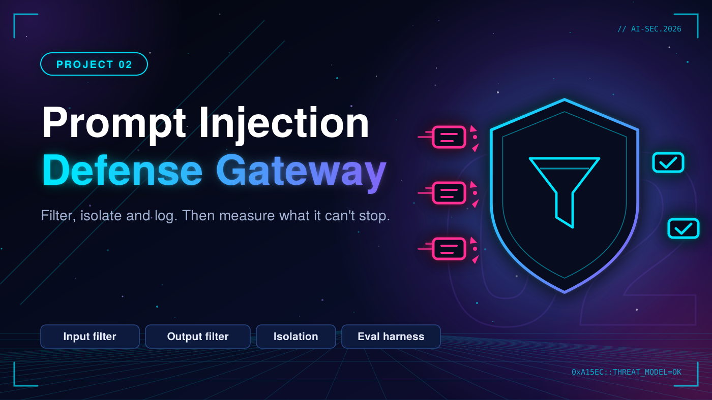

# 02. Prompt Injection Defense Gateway



A proxy layer between users and an LLM that filters input and output, isolates untrusted context, and logs everything, with an evaluation harness that measures it honestly.

> Status: 🚧 In progress

## Goal and threat model

_Describe the system, trust boundaries, assets, attacker capabilities and attack paths. Add a diagram (STRIDE / MITRE ATLAS)._

## Tools

- Python / FastAPI (or your stack)
- Regex + classifier based detection
- Structured logging (SIEM-friendly)

## Roadmap

- [ ] Input filtering: injection patterns, encoded payloads, suspicious instructions
- [ ] Output filtering: leaked secrets, PII, unsafe content
- [ ] Context isolation: trusted instructions vs untrusted data
- [ ] Structured logging and alerting
- [ ] Evaluation harness: attack dataset, detection rate, false positive rate, latency overhead
- [ ] Document what the gateway can NOT stop

## Repository layout

```
prompt-injection-gateway/
├── gateway/
├── eval/
├── datasets/
└── docs/
```

## Results

| Metric | Value |
|---|---|
| Detection rate | _..._ |
| False positive rate | _..._ |
| Latency overhead | _... ms_ |

## Limitations

_Be honest about what this does not cover or cannot stop._

## References

- OWASP Top 10 for LLM Applications
- MITRE ATLAS
- NIST AI RMF

## Responsible use

Everything here targets my own lab environment or open-source/authorized targets only.
